  

  
  
  
  
  

| &nbsp;  &nbsp; |                &nbsp;  &nbsp;                |                  &nbsp;                    | &nbsp;  &nbsp;&nbsp;&nbsp;&nbsp;&nbsp;&nbsp;&nbsp;&nbsp;&nbsp;&nbsp;&nbsp;&nbsp;&nbsp;&nbsp;&nbsp;&nbsp;&nbsp;&nbsp;&nbsp;&nbsp;&nbsp;&nbsp;&nbsp;&nbsp;&nbsp;&nbsp;&nbsp;&nbsp;&nbsp;&nbsp; | &nbsp;  &nbsp;&nbsp;&nbsp;&nbsp;&nbsp;&nbsp;&nbsp;&nbsp;&nbsp;&nbsp;&nbsp;&nbsp;&nbsp;&nbsp;&nbsp;&nbsp;&nbsp;&nbsp;&nbsp;&nbsp;&nbsp;&nbsp;&nbsp;&nbsp; | &nbsp;  &nbsp; |
| :----------------------------------------------------------------------------: | :----------------------------------------------------------------------------------------------------------------------: | :---------------------------------------------------------------------------------------------------------------------------------------------------------------------------: | :--------------------------------------------------------------------------------------------------------------------------------------------------------------------------------------------------------------------------------------------------------------: | :------------------------------------------------------------------------------------------------------------------------------------------------------------------------------------------------------------------------------: | :--------------------------------------------------------------------------------: |
|                               <code>#172</code>                                |                                                     **Undisclosed**                                                      |                                                                                                                                                                               |                                                                                                                                                                                                                                |                                                                                                                                                                                                        |                           <code>October&nbsp;2026</code>                           |
|                               <code>#171</code>                                |                                        **[Unhosted](https://www.unhosted.com/)**                                         |                                                                      Wallet Custody & Signing Authority                                                                       |                                                                                                                                                                                                                                |                                                                                                                                                                                                        |                           <code>October&nbsp;2026</code>                           |
|                               <code>#170</code>                                |                          **[Rabtools]()**                           |                                                 <small>DeFi Treasury Automation (Reward Claiming & Auto-Compounding)</small>                                                  |                                                                                                                                                                                                                                |                                                                                                                                                          |                           <code>October&nbsp;2026</code>                           |
|                               <code>#169</code>                                |         **[Pear Protocol](https://www.pear.garden/)**           |                                                                       ERC-4626 Delegated Trading Vaults                                                                       |                                                                                                                                                                                                                                |                                                                                                                                                                                                        |                           <code>October&nbsp;2026</code>                           |
|                               <code>#168</code>                                |            **[Dark Wallet](https://darkwallet.cash/)**              |                                                      <small>Confidential Payments Vault (ZK-Encrypted Balances)</small>                                                       |                                                                                                                                                                                                                                |                                                                                                                                                        |                           <code>October&nbsp;2026</code>                           |
|                               <code>#167</code>                                |            **[Yield Fields](https://yieldfields.fun/)**             |                                                    <small>NFT Collection, Dutch Auction Mint (ERC721A / ERC721-C)</small>                                                     |                                                                                                                                                                                                                                |                                                                                                                                                                                                  |                           <code>October&nbsp;2026</code>                           |
|                               <code>#166</code>                                |         **[Pear Protocol](https://www.pear.garden/)**           |                                                     <small>Cross-Chain Token & Staking Migration (LayerZero OFT)</small>                                                      |                                                                                                                                                                                                                                |                                                                                                                                        |                           <code>October&nbsp;2026</code>                           |
|                               <code>#165</code>                                |                                   **[Passkeys Wallet](https://passkeys.foundation/)**                                    |                                                <small>Enterprise Smart Contract Wallet (ERC-4337 Account Abstraction)</small>                                                 |                                                                                                                                                                                                                                |                                                                                                                                                                                                  |                          <code>September&nbsp;2026</code>                          |
|                               <code>#164</code>                                |              **[Shrooms.Fun](https://shrooms.fun/)**                |                                                  <small>Token-Gated Community Platform (Fee Splitters & Tip Escrow)</small>                                                   |                                                                                                                                                                                                                                |                                                                                                                                                        |                          <code>September&nbsp;2026</code>                          |
|                               <code>#163</code>                                |                                         **[Multipli.fi](https://multipli.fi/)**                                          |                                                          <small>ERC-20, Token Distribution / Claim Contracts</small>                                                          |                                                                                                                                                                                                                                |                                                                                                                                                                                                        |                          <code>September&nbsp;2026</code>                          |
|                               <code>#162</code>                                |                                                      **[Trace]()**                                                       |                                        <small>Fully On-Chain NFT Collection — Sale, Raffle & Off-Chain Deterministic Allocator</small>                                        |                                                                                                                                                                                                                                |                                                                                                                                                                                                        |                          <code>September&nbsp;2026</code>                          |
|                               <code>#161</code>                                |             **[Topaz Dex](https://www.topazdex.com/)**              |                                           <small>Omnichain ve(3,3) Liquidity & Emissions Protocol (LayerZero hub-and-spoke)</small>                                           |                                                                                                                                                                                                                                |                                                                                                                                                           |                           <code>August&nbsp;2026</code>                            |
|                               <code>#160</code>                                |             **[OffYield](https://www.offyield.com/)**               |                                                 <small>Yield-Bearing Stablecoin Vault (Spendable-Yield Card Product)</small>                                                  |                                                                                                                                                                                                                                |                                                                                                                                                          |                           <code>August&nbsp;2026</code>                            |
|                               <code>#159</code>                                |           **[Buoy Finance](https://buoy.finance/)**             |                                                <small>Non-Custodial Perpetuals Vault Platform (Hyperliquid / HyperEVM)</small>                                                |                                                                                                                                                                                                                                |                                                                                                                                                              |                           <code>August&nbsp;2026</code>                            |
|                               <code>#158</code>                                |                 **[Rini](https://rini.xyz/)**                   |                                                                    <small>DeFi, ERC-7540 Vault OS</small>                                                                     |                                                                                                                                                                                                                                |                                                                                                                                                              |                            <code>July&nbsp;2026</code>                             |
|                               <code>#157</code>                                |         **[Pear Protocol](https://www.pear.garden/)**           |                                                      <small>Off-Chain Vault Custody, Signing & Reporting Service</small>                                                      |                                                                                                                                                                                                                    |                                                                                                                                       |                            <code>July&nbsp;2026</code>                             |
|                               <code>#156</code>                                |         **[Pear Protocol](https://www.pear.garden/)**           |                                                                   <small>DeFi, ERC-4626 Vault - V2</small>                                                                    |                                                                                                                                                                                                                                |                                                                                                                                             |                            <code>June&nbsp;2026</code>                             |
|                               <code>#155</code>                                |                                    **[Bankroll Network](https://bankroll.network/)**                                     |                                                                      <small>DeFi, vltUSDC Vault</small>                                                                       |                                                                                                                                                                                                                                |                                                                                                                                                    |                            <code>June&nbsp;2026</code>                             |
|                               <code>#154</code>                                |                    **[Up](https://up33.xyz/)**                      |                                                                       <small>DeFi, ve(3,3) DEX</small>                                                                        |                                                                                                                                                                                                                                |                                                                                                                                                                |                            <code>June&nbsp;2026</code>                             |
|                               <code>#153</code>                                |                                    **[Bankroll Network](https://bankroll.network/)**                                     |                                                                  <small>ERC-20, Store-of-Value Token</small>                                                                  |                                                                                                                                                                                                                                |                                                                                                                                                      |                             <code>May&nbsp;2026</code>                             |
|                               <code>#152</code>                                |                                      **[Colb Finance](https://www.colb.finance/)**                                       |                                                                        <small>Escrow, EIP-712</small>                                                                         |                                                                                                                                                                                                                                |                                                                                                                                                                                                        |                             <code>May&nbsp;2026</code>                             |
|                               <code>#151</code>                                |                                   **[Multipli.fi - MULT Token](https://multipli.fi/)**                                   |                                                                       <small>BurnMintERC20UUPS</small>                                                                        |                                                                                                                                                                                                                                |                                                                                                                                                                                                  |                             <code>May&nbsp;2026</code>                             |
|                               <code>#150</code>                                |         **[Onchain Heroes](https://www.onchainheroes.xyz/)**          |                                                                      <small>GameFi - Valor Vault</small>                                                                      |                                                                                                                                                                                                                                |                                                                                                                                               |                            <code>April&nbsp;2026</code>                            |
|                               <code>#149</code>                                |                   **[Topaz Dex](https://www.topazdex.com/)**                    |                                                       <small>AMM, DEX, Concentrated Liquidity, Uniswap V3 Fork</small>                                                        |                                                                                                                                                                                                                                |                                                                                                                                                         |                            <code>April&nbsp;2026</code>                            |
|                               <code>#148</code>                                |                                  **[Rewardy Wallet](https://www.rewardywallet.com/en)**                                  |                                                                        <small>EIP-7702 wallet</small>                                                                         |                                                                                                                                                                                                                                |                                                                                                                                             |                            <code>April&nbsp;2026</code>                            |
|                               <code>#147</code>                                |           **[DEPTH Protocol](https://www.depthsoul.com/)**            |                                                                <small>Vault, ERC-721, ERC-5192, ERC-20</small>                                                                |                                                                                                                                                                                                                                |                                                                                                                                                     |                            <code>April&nbsp;2026</code>                            |
|                               <code>#146</code>                                |                                     **[SpringX Finance](https://springx.finance/)**                                      |                                                          <small>Staking & Yield Farming Protocol (Fixed-APR)</small>                                                          |                                                                                                                                                                                                                                |                                                                                                                                                           |                            <code>March&nbsp;2026</code>                            |
|                               <code>#145</code>                                |                                                     **Undisclosed**                                                      |                                                       <small>Automated Market Maker (AMM), UniswapV3 SwapRouter</small>                                                       |                                                                                                                                                                                                                                |                                                                                                                                                                                                        |                            <code>March&nbsp;2026</code>                            |
|                               <code>#144</code>                                |                   **[Tulpea](https://tulpea.org/)**                     |                                                                 <small>DeFi, ERC-4626 Vault, ERC-7540</small>                                                                 |                                                                                                                                                                                                                                |                                                                                                                                                            |                            <code>March&nbsp;2026</code>                            |
|                               <code>#143</code>                                |         **[Pear Protocol](https://www.pear.garden/)**           |                                                                      <small>DeFi, ERC-4626 Vault</small>                                                                      |                                                                                                                                                                                                                                |                                                                                                                                       |                          <code>February&nbsp;2026</code>                           |
|                               <code>#142</code>                                |          **[Crush Trading](https://www.crush.xyz/)**            |                                                               <small>AI-assisted Quant Trading Platform</small>                                                               |                                                                                                                                                                                                                               |                                                                                                                                                      |                          <code>February&nbsp;2026</code>                           |
|                               <code>#141</code>                                |                       **[Fast Protocol (Primev) - Fast Settlement V3](https://fastprotocol.io/)**                        |                                                                      <small>DeFi, Infrastructure</small>                                                                      |                                                                                                                                                                                                                                |                                                                                                                                         |                          <code>February&nbsp;2026</code>                           |
|                               <code>#140</code>                                |                                **[Colb Finance - Multicall](https://www.colb.finance/)**                                 |                                                                     <small>RWAs, Pre-IPO, Liquids</small>                                                                     |                                                                                                                                                                                                                                |                                                                                                                                             |                          <code>February&nbsp;2026</code>                           |
|                               <code>#139</code>                                | **[Onchain Heroes (Maze of Gains)](https://www.onchainheroes.xyz/)**  |                                                                             <small>GameFi</small>                                                                             |                                                                                                                                                                                                                                |                                                                                                                                        |                           <code>January&nbsp;2026</code>                           |
|                               <code>#138</code>                                |                                     **[Stormrae](https://stormrae.ai/)**  |                                                                      <small>AI Development Layer</small>                                                                      |                                                                                                                                                                                                                                 |                                                                                                                                                          |                           <code>January&nbsp;2026</code>                           |
|                               <code>#137</code>                                |        **[Roots of Embervault (Ruyui)](https://ruyui.com/)**          |                                                                      <small>GameFi, Marketplace</small>                                                                       |                                                                                                                                                                                                                                |                                                                                                                                           |                           <code>January&nbsp;2026</code>                           |
|                               <code>#136</code>                                |           **[Shiny (Payment Router)](https://shiny.com/)**            |                                                                     <small>RWA, Treasury, EIP-712</small>                                                                     |                                                                                                                                                                                                                                |                                                                                                                                               |                           <code>January&nbsp;2026</code>                           |
|                               <code>#135</code>                                |                        **[Jailed (Pandemic Labs)](https://jailed.fun/)**  |                                                                          <small>GameFi, VRF</small>                                                                           |                                                                                                                                                                                                                                 |                                                                                                                                                                                                  |                           <code>January&nbsp;2026</code>                           |
|                               <code>#134</code>                                |   **[Infinite Beyond (Star Wolvez)](https://www.starwolvez.com/)**    |                                                                  <small>GameFi, ERC-721, Pyth Oracle</small>                                                                  |                                                                                                                                                                                                                                |                                                                                                                                                       |                           <code>January&nbsp;2026</code>                           |
|                               <code>#133</code>                                |            **[Tollan Universe](https://hub.tollan.io/)**              |                                                    <small>GameFi - Elemental affinities using Proof of Play’s vRNG</small>                                                    |                                                                                                                                                                                                                                |                                                                                                                                                    |                          <code>December&nbsp;2025</code>                           |
|                               <code>#132</code>                                |                   **[Shiny](https://shiny.com/)**                     |                                                                     <small>RWA, Treasury, EIP-712</small>                                                                     |                                                                                                                                                                                                                                |                                                                                                                                                             |                          <code>December&nbsp;2025</code>                           |
|                               <code>#131</code>                                |                                     **[Prime Vaults](https://primevaults.finance/)**                                     |                                                    <small>DeFi, Principal Protection and Guaranteed Minimum Yield</small>                                                     |                                                                                                                                                                                                                                |                                                                                                                                                      |                          <code>December&nbsp;2025</code>                           |
|                               <code>#130</code>                                |                                      **[Toki Finance](https://x.com/tokifinance)**                                       |                                                                          <small>DeFi, Bridge</small>                                                                          |                                                                                                                                                                                                                                |                                                                                                                                                       |                          <code>November&nbsp;2025</code>                           |
|                               <code>#129</code>                                |            **[Dropster (Abster)](https://dropster.fun/)**             |                                                                             <small>GameFi</small>                                                                             |                                                                                                                                                                                                                                |                                                                                                                                                            |                          <code>November&nbsp;2025</code>                           |
|                               <code>#128</code>                                |         **[Pear Protocol](https://www.pear.garden/)**           |                                                                      <small>DeFi, ERC-4626 Vault</small>                                                                      |                                                                                                                                                                                                                                |                                                                                                                                                |                          <code>November&nbsp;2025</code>                           |
|                               <code>#127</code>                                |                                 **[Colb Finance - Liquids](https://www.colb.finance/)**                                  |                                                                     <small>RWAs, Pre-IPO, Liquids</small>                                                                     |                                                                                                                                                                                                                                |                                                                                                                                               |                          <code>November&nbsp;2025</code>                           |
|                               <code>#126</code>                                |            **[Souls.club (Wheel)](https://souls.club/)**              |                                                                    <small>GameFi, ETH Staking, VRF</small>                                                                    |                                                                                                                                                                                                                                |                                                                                                                                                   |                          <code>November&nbsp;2025</code>                           |
|                               <code>#125</code>                                |                           **Undisclosed**                             |                                                                           <small>Launchpad</small>                                                                            |                                                                                                                                                                                                                                |                                                                                                                                                                                                        |                          <code>November&nbsp;2025</code>                           |
|                               <code>#124</code>                                |          **[Harmonix Finance](https://harmonix.fi/)**           |                                                                         <small>HAR Token Sale</small>                                                                         |                                                                                                                                                                                                                                |                                                                                                                              |                          <code>November&nbsp;2025</code>                           |
|                               <code>#123</code>                                |             **[Spellborne](https://www.spellborne.gg/)**              |                                                      <small>ERC721C NFT with Royalty Enforcement, Token Vesting</small>                                                       |                                                                                                                                                                                                                                |                                                                                                                                        |                          <code>November&nbsp;2025</code>                           |
|                               <code>#122</code>                                |                                  **[Rewardy Wallet](https://www.rewardywallet.com/en)**                                  |                                                                     <small>OFT, Bridge, Ownership</small>                                                                     |                                                                                                                                                                                                                                        |                                                                                                                                                           |                          <code>November&nbsp;2025</code>                           |
|                               <code>#121</code>                                |                **[HLOS](https://x.com/__HLOS)**                 |                                                                      <small>Trading API Backend</small>                                                                       |                                                                                                                                                                                                                              |                                                                                                                                                              |                           <code>October&nbsp;2025</code>                           |
|                               <code>#120</code>                                |          **[Harmonix Finance](https://harmonix.fi/)**           |                                                             <small>Yield Optimizer, Vesting, ERC20Permit</small>                                                              |                                                                                                                                                                                                                                |                                                                                                                               |                           <code>October&nbsp;2025</code>                           |
|                               <code>#119</code>                                |          **[Harmonix Finance](https://harmonix.fi/)**           |                                                                          <small>$HAR - ERC20</small>                                                                          |                                                                                                                                                                                                                                |                                                                                                                                                                                                  |                           <code>October&nbsp;2025</code>                           |
|                               <code>#118</code>                                |           **[Pudgy Strategy](https://pudgystrategy.net/)**            |                                                                       <small>ERC20, NFT Vaults</small>                                                                        |                                                                                                                                                                                                                                |                                                                                                                                                     |                           <code>October&nbsp;2025</code>                           |
|                               <code>#117</code>                                |           **[Aborean Finance](https://aborean.finance/)**             |                                                              <small>DEX, The liquidity layer of Abstract</small>                                                              |                                                                                                                                                                                                                                |                                                                                                                                                                                                  |                           <code>October&nbsp;2025</code>                           |
|                               <code>#116</code>                                |                               **[Colb Finance - USC OffRamp](https://www.colb.finance/)**                                |                                                                   <small>RWA, Pre-IPO, USC OffRamp</small>                                                                    |                                                                                                                                                                                                                                |                                                                                                                                           |                           <code>October&nbsp;2025</code>                           |
|                               <code>#115</code>                                |             **[Spellborne](https://www.spellborne.gg/)**              |                                                      <small>ERC721C NFT with Royalty Enforcement + Token Locking</small>                                                      |                                                                                                                                                                                                                                |                                                                                                                                                        |                           <code>October&nbsp;2025</code>                           |
|                               <code>#114</code>                                |                                   **[Honeypot Finance](https://honeypotfinance.xyz/)**                                   |                                                                 <small>ERC-20, ERC-721, NFT, Staking</small>                                                                  |                                                                                                                                                                                                                                |                                                                                                                                       |                          <code>September&nbsp;2025</code>                          |
|                               <code>#113</code>                                |                                **[Colb Finance - USC Engine](https://www.colb.finance/)**                                |                                                                    <small>RWA, Pre-IPO, USC Engine</small>                                                                    |                                                                                                                                                                                                                                |                                                                                                                                            |                          <code>September&nbsp;2025</code>                          |
|                               <code>#112</code>                                |                                       **[Terplayer - BVT](https://terplayer.org)**                                       |                                                               <small>Vault Token, Staking, Distribution</small>                                                               |                                                                                                                                                                                                                                |                                                                                                                                 |                          <code>September&nbsp;2025</code>                          |
|                               <code>#111</code>                                |                                     **[Terplayer - BeraBTC](https://terplayer.org)**                                     |                                                                       <small>ERC20, Vault Token</small>                                                                       |                                                                                                                                                                                                                                |                                                                                                                                      |                          <code>September&nbsp;2025</code>                          |
|                               <code>#110</code>                                |                            **[Etherspot - Gas Tank Paymaster Module](https://etherspot.io/)**                            |                                                                       <small>ERC-7579, EIP-712</small>                                                                        |                                                                                                                                                                                                                                |                                                                                                                                              |                          <code>September&nbsp;2025</code>                          |
|                               <code>#109</code>                                |                             **[Colb Finance - Vault (Extended)](https://www.colb.finance/)**                             |                                                                      <small>RWA, Pre-IPO, Vault</small>                                                                       |                                                                                                                                                                                                                                |                                                                                                                                        |                          <code>September&nbsp;2025</code>                          |
|                               <code>#108</code>                                |           **[Souls.club (Revolver)](https://souls.club/)**            |                                                         <small>Game built on zkSync with VRF-based randomness</small>                                                         |                                                                                                                                                                                                                                |                                                                                                                                                |                          <code>September&nbsp;2025</code>                          |
|                               <code>#107</code>                                |                                                       **BeraRoot**                                                       |                                                                         <small>DeFi, Staking</small>                                                                          |                                                                                                                                                                                                                                |                                                                                                                                                          |                           <code>August&nbsp;2025</code>                            |
|                               <code>#106</code>                                |              **[Beetle Game](https://beetlegame.com/)**               |                                                        <small>GameFi - Digital Card Collecting & Battling Game</small>                                                        |                                                                                                                                                                                                                                |                                                                                                                                                            |                           <code>August&nbsp;2025</code>                            |
|                               <code>#105</code>                                |                                                      **SSR Token**                                                       |                                                           <small>LayerZero, Omnichain Fungible Token (OFT)</small>                                                            |                                                                                                                                                                                                                                |                                                                                                                                                                                                  |                           <code>August&nbsp;2025</code>                            |
|                               <code>#104</code>                                |         **[Onchain Heroes](https://www.onchainheroes.xyz/)**          |                                                            <small>ERC-721, Abstract Bridge Using LayerZero</small>                                                            |                                                                                                                                                                                                                                |                                                                                                                                       |                           <code>August&nbsp;2025</code>                            |
|                               <code>#103</code>                                |         **[Onchain Heroes](https://www.onchainheroes.xyz/)**          |                                                                  <small>GameFi - Season 2 (Phase 2)</small>                                                                   |                                                                                                                                                                                                                                |                                                                    -Security-Review.pdf>)                                                                    |                            <code>July&nbsp;2025</code>                             |
|                               <code>#102</code>                                |                             **[Adrastea Finance](https://adrastea.fi/)**  |                                                                <small>DeFi, Liquid restaking protocol</small>                                                                 |                                                                                                                                                                                                                                 |                                                                                                                                                                                                  |                            <code>July&nbsp;2025</code>                             |
|                               <code>#101</code>                                |                           **Undisclosed**                             |                                                                           <small>Launchpad</small>                                                                            |                                                                                                                                                                                                                                |                                                                                                                                                                                                        |                            <code>July&nbsp;2025</code>                             |
|                               <code>#100</code>                                |                                      **[Colb Finance](https://www.colb.finance/)**                                       |                                                                     <small>Front End, TypeScript</small>                                                                      |                                                                                                                                                                                                                    |                                                                                                                                                  |                            <code>July&nbsp;2025</code>                             |
|                                <code>#99</code>                                |                             **[Etherspot - Credible Account Module](https://etherspot.io/)**                             |                                                                       <small>ERC-7579, EIP-712</small>                                                                        |                                                                                                                                                                                                                                |                                                                                                                                           |                            <code>July&nbsp;2025</code>                             |
|                                <code>#98</code>                                |                                  **[GlueX Protocol - V2](https://x.com/GluexProtocol)**                                  |                                                                          <small>DeFi, Router</small>                                                                          |                                                                                                                                                                                                                                |                                                                                                                                                          |                            <code>June&nbsp;2025</code>                             |
|                                <code>#97</code>                                |         **[Onchain Heroes](https://www.onchainheroes.xyz/)**          |                                                                    <small>GameFi - Fishing Voyages</small>                                                                    |                                                                                                                                                                                                                                |                                                                                                                                      |                            <code>June&nbsp;2025</code>                             |
|                                <code>#96</code>                                |                                           **[Credifi](https://www.credi.fi/)**                                           |                                                    <small>DeFi, ERC-1155 NFTs, Euler V2 Vaults (Lending/Borrowing)</small>                                                    |                                                                                                                                                                                                                                |                                                                                                                                                           |                            <code>June&nbsp;2025</code>                             |
|                                <code>#95</code>                                |                                     **[Multipli.fi - Vault](https://multipli.fi/)**                                      |                                                                      <small>DeFi, ERC-4626 Vault</small>                                                                      |                                                                                                                                                                                                                                |                                                                                                                                                    |                            <code>June&nbsp;2025</code>                             |
|                                <code>#94</code>                                |                                  **[Colb Finance - Vault](https://www.colb.finance/)**                                   |                                                                      <small>RWA, Pre-IPO, Vault</small>                                                                       |                                                                                                                                                                                                                                |                                                                                                                                                 |                            <code>June&nbsp;2025</code>                             |
|                                <code>#93</code>                                |                             **[Etherspot - Credible Account Module](https://etherspot.io/)**                             |                                                                       <small>ERC-7579, EIP-712</small>                                                                        |                                                                                                                                                                                                                                |                                                                                                                                                     |                            <code>June&nbsp;2025</code>                             |
|                                <code>#92</code>                                |         **[Onchain Heroes](https://www.onchainheroes.xyz/)**          |                                                                  <small>GameFi - Season 2 (Phase 1)</small>                                                                   |                                                                                                                                                                                                                                |                                                                                                                                                                                                  |                            <code>June&nbsp;2025</code>                             |
|                                <code>#91</code>                                |               **[Pudgy DAOs](https://pudgydaos.com)**                 |                                                                         <small>DAOs Launchpad</small>                                                                         |                                                                                                                                                                                                                                |                                                                                                                                                         |                             <code>May&nbsp;2025</code>                             |
|                                <code>#90</code>                                |                                   **[Jiko (by Beraji)](https://x.com/Jikofunfinance)**                                   |                                                                <small>Yield Optimizer, Staking Module</small>                                                                 |                                                                                                                                                                                                                                |                                                                                                                                                         |                             <code>May&nbsp;2025</code>                             |
|                                <code>#89</code>                                |           **[PenguinGotchi](https://x.com/PenguinGotchi)**            |                                                                             <small>GameFi</small>                                                                             |                                                                                                                                                                                                                                |                                                                                                                                                     |                             <code>May&nbsp;2025</code>                             |
|                                <code>#88</code>                                |                                         **[Multipli.fi](https://multipli.fi/)**                                          |                                                                <small>DeFi, Yield on Tokenised Assets</small>                                                                 |                                                                                                                                                                                                                                |                                                                                                                                                          |                             <code>May&nbsp;2025</code>                             |
|                                <code>#87</code>                                |                                      **[Terplayer - Hodl](https://terplayer.org)**                                       |                                                                    <small>DeFi, Lending, Borrowing</small>                                                                    |                                                                                                                                                                                                                                |                                                                                                                                                    |                             <code>May&nbsp;2025</code>                             |
|                                <code>#86</code>                                |                                 **[Swappee](https://app.smilee.finance/swappee/claim)**                                  |                                                                 <small>DeFi, Proof of Liquidity game</small>                                                                  |                                                                                                                                                                                                                                |                                                                                                                                                           |                            <code>April&nbsp;2025</code>                            |
|                                <code>#85</code>                                |          **[Harmonix Finance](https://harmonix.fi/)**           |                                                      <small>DeFi, ERC-4626, Yield Optimization with Hyperliquid</small>                                                       |                                                                                                                                                                                                                                |                                                                                                                                       |                            <code>April&nbsp;2025</code>                            |
|                                <code>#84</code>                                |                                 **[Terplayer - BeraBTC](https://terplayer.org/berabtc)**                                 |                                                                       <small>Upgradeable ERC20</small>                                                                        |                                                                                                                                                                                                                                |                                                                                                                                                 |                            <code>April&nbsp;2025</code>                            |
|                                <code>#83</code>                                |                                       **[Bullas - V2](https://game.bullas.xyz/)**                                        |                                                                          <small>DeFi, Gaming</small>                                                                          |                                                                                                                                                                                                                                |                                                                                                                                                          |                            <code>March&nbsp;2025</code>                            |
|                                <code>#82</code>                                |                                       **[Cured Finance](https://x.com/cured_fi)**                                        |                                                     <small>DeFAI (DeFi + AI), Yield and Liquidity Hub, Uniswap V2</small>                                                     |                                                                                                                                                                                                                                |                                                                                                                                                                                                  |                            <code>March&nbsp;2025</code>                            |
|                                <code>#81</code>                                |                                     **[Berally - Staking V2](https://berally.io/)**                                      |                                                                         <small>DeFi, Staking</small>                                                                          |                                                                                                                                                                                                                                |                                                                                                                                                 |                            <code>March&nbsp;2025</code>                            |
|                                <code>#80</code>                                |                                    **[Möbius Exchange](https://www.mobius.exchange)**                                    |                                                                            <small>DEX, AMM</small>                                                                            |                                                                                                                                                                                                                                |                                                                                                                                                    |                            <code>March&nbsp;2025</code>                            |
|                                <code>#79</code>                                |                                                    **Beef's Finance**                                                    |                                                                   <small>Meme-driven cryptocurrency</small>                                                                   |                                                                                                                                                                                                                                |                                                                                                                                                    |                            <code>March&nbsp;2025</code>                            |
|                                <code>#78</code>                                |                                        **[H4SHFund](https://www.h4shfund.com/)**                                         |                                                                     <small>DeFi, Tokens launchpad</small>                                                                     |                                                                                                                                                                                                                                |                                                                                                                                                          |                            <code>March&nbsp;2025</code>                            |
|                                <code>#77</code>                                |                                       **[Stax - TitanX](https://element280.win/)**                                       |                                                                         <small>DeFi, Staking</small>                                                                          |                                                                                                                                                                                                                                |                                                                                                                                                              |                          <code>February&nbsp;2025</code>                           |
|                                <code>#76</code>                                |                                     **[Harvest Flow - V2](https://harvestflow.io/)**                                     |                                                                      <small>NFT Lending Protocol</small>                                                                      |                                                                                                                                                                                                                                |                                                                                                                                                   |                          <code>February&nbsp;2025</code>                           |
|                                <code>#75</code>                                |                                      **[Beraji-KO](https://x.com/Jikofunfinance)**                                       |                                                                         <small>DeFi, Staking</small>                                                                          |                                                                                                                                                                                                                                |                                                                                                                                                         |                          <code>February&nbsp;2025</code>                           |
|                                <code>#74</code>                                |                                                   **Sparta - TitanX**                                                    |                                                                             <small>ERC-20</small>                                                                             |                                                                                                                                                                                                                                |                                                                                                                                                            |                          <code>February&nbsp;2025</code>                           |
|                                <code>#73</code>                                |                                   **[Stacking Salmon](https://x.com/stackingsalmon)**                                    |                                                               <small>DeFi, Lending protocol, Kodiak V3</small>                                                                |                                                                                                                                                                                                                                |                                                                                                                                                    |                          <code>February&nbsp;2025</code>                           |
|                                <code>#72</code>                                |                         **[Honeypot Finance - Pot2Pump Updates](https://honeypotfinance.xyz/)**                          |                                                           <small>DEX, Proof-of-Liquidity (PoL) Accelerator</small>                                                            |                                                                                                                                                                                                                                |                                                                                                                                          |                           <code>January&nbsp;2025</code>                           |
|                                <code>#71</code>                                |                                        **[Berally - Pass](https://berally.io/)**                                         |                                                                          <small>Social token</small>                                                                          |                                                                                                                                                                                                                                |                                                                                                                                                    |                           <code>January&nbsp;2025</code>                           |
|                                <code>#70</code>                                |                                       **[Berally - Staking](https://berally.io/)**                                       |                                                                         <small>DeFi, Staking</small>                                                                          |                                                                                                                                                                                                                                |                                                                                                                                                   |                           <code>January&nbsp;2025</code>                           |
|                                <code>#69</code>                                |                                       **[Flare - TitanX](https://www.flare.win/)**                                       |                                                               <small>DeFi, Buy and Burn, Auction, Mint</small>                                                                |                                                                                                                                                                                                                                |                                                                                                                                                             |                           <code>January&nbsp;2025</code>                           |
|                                <code>#68</code>                                |                                  **[Yeet Cup - NFT Vesting](https://www.yeetit.xyz/)**                                   |                                                                          <small>NFT Vesting</small>                                                                           |                                                                                                                                                                                                                                |                                                                                                                                                   |                           <code>January&nbsp;2025</code>                           |
|                                <code>#67</code>                                |                                                    **DFDX - TitanX**                                                     |                                                                             <small>ERC-20</small>                                                                             |                                                                                                                                                                                                                                |                                                                                                                                                              |                           <code>January&nbsp;2025</code>                           |
|                                <code>#66</code>                                |          **[Harmonix Finance](https://harmonix.fi/)**           |                                                      <small>DeFi, ERC-4626, Yield Optimization with Hyperliquid</small>                                                       |                                                                                                                                                                                                                                |                                                                                                                                                                                                  |                           <code>January&nbsp;2025</code>                           |
|                                <code>#65</code>                                |                                          **[Berabot](https://x.com/Berabot_)**                                           |                                                                 <small>DEX Aggregator , Uniswap V2/V3</small>                                                                 |                                                                                                                                                                                                                                |                                                                                                                                                           |                           <code>January&nbsp;2025</code>                           |
|                                <code>#64</code>                                |                               **[Guanciale - Stake](https://terminal.guanciale.ai/stake)**                               |                                                                         <small>DeFi, Staking</small>                                                                          |                                                                                                                                                                                                                                |                                                                                                                                                   |                          <code>December&nbsp;2024</code>                           |
|                                <code>#63</code>                                |                                    **[Surge - TitanX](https://app.volt.win/auction)**                                    |                                                                   <small>DeFi, Buy & Burn, Staking</small>                                                                    |                                                                                                                                                                                                                                |                                                                                                                                                             |                          <code>December&nbsp;2024</code>                           |
|                                <code>#62</code>                                |                                    **[Rooster Protocol](https://www.rooster.trade/)**                                    |                                                             <small>DEX, Built on top of the Maverick AMM</small>                                                              |                                                                                                                                                                                                                                |                                                                                                                                                   |                          <code>December&nbsp;2024</code>                           |
|                                <code>#61</code>                                |                                   **[Kaizen - TitanX](https://app.volt.win/auction)**                                    |                                                                         <small>DeFi, Staking</small>                                                                          |                                                                                                                                                                                                                                |                                                                                                                                                            |                          <code>December&nbsp;2024</code>                           |
|                                <code>#60</code>                                |                                    **[GlueX Protocol](https://x.com/GluexProtocol)**                                     |                                                                          <small>DeFi, Router</small>                                                                          |                                                                                                                                                                                                                                |                                                                                                                                                             |                          <code>December&nbsp;2024</code>                           |
|                                <code>#59</code>                                |                                 **[Vyper Boost - TitanX](https://app.volt.win/auction)**                                 |                                                                         <small>DeFi, Staking</small>                                                                          |                                                                                                                                                                                                                                |                                                                                                                                                       |                          <code>December&nbsp;2024</code>                           |
|                                <code>#58</code>                                |                                      **[Dinero - Super ETH](https://dinero.xyz/)**                                       |                               <small>DeFi, Liquidity Staking (Enabling users to receive OFT tokens on any whitelisted layer 2 network)</small>                                |                                                                                                                                                                                                                                |                                                                                                                                                   |                          <code>November&nbsp;2024</code>                           |
|                                <code>#57</code>                                |                                   **[Honeypot Finance](https://honeypotfinance.xyz/)**                                   |                                                           <small>DEX, Proof-of-Liquidity (PoL) Accelerator</small>                                                            |                                                                                                                                                                                                                                |                                                                                                                                                   |                          <code>November&nbsp;2024</code>                           |
|                                <code>#56</code>                                |                                           **[Azuki](https://www.azuki.com/)**                                            |                                                                  <small>NFT, Token Claim and Runbook</small>                                                                  |                                                                                                                                                                                                                                |                                                                                                                                                                                                  |                          <code>November&nbsp;2024</code>                           |
|                                <code>#55</code>                                |                                    **[Vyper - TitanX](https://app.volt.win/auction)**                                    |                                                                         <small>DeFi, Staking</small>                                                                          |                                                                                                                                                                                                                                |                                                                                                                                                             |                           <code>October&nbsp;2024</code>                           |
|                                <code>#54</code>                                |                                       **[Goose Run - V1](https://www.goose.run/)**                                       |                                           <small>DeFi, Launch & Borrow Memecoins without liquidation, Built on Maverick V2</small>                                            |                                                                                                                                                                                                                                |                                                                                                                                                       |                           <code>October&nbsp;2024</code>                           |
|                                <code>#53</code>                                |                             **[Adrastea Finance](https://adrastea.fi/)**  |                                                                <small>DeFi, Liquid restaking protocol</small>                                                                 |                                                                                                                                                                                                                                 |                                                                                                                                                          |                           <code>October&nbsp;2024</code>                           |
|                                <code>#52</code>                                |                    **[Kanpai Pandas - ONFT](https://kanpaipandas.com/)**  |                         <small>Omnichain Non-Fungible Token (ONFT) on the Solana blockchain using LayerZero's cross-chain messaging protocol</small>                          |                                                                                                                                                                                                                                 |                                                                                                                                            |                          <code>September&nbsp;2024</code>                          |
|                                <code>#51</code>                                |                                         **[Goose Run](https://www.goose.run/)**                                          |                                           <small>DeFi, Launch & Borrow Memecoins without liquidation, Built on Maverick V2</small>                                            |                                                                                                                                                                                                                                |                                                                                                                                                          |                          <code>September&nbsp;2024</code>                          |
|                                <code>#50</code>                                |                                                **Dedprz - Virtual Labs**                                                 |                     <small>Coin flip game, where can place predetermined or customized bets using the $SUSA balance stored in a connected wallet</small>                      |                                                                                                                                                                                                                      |                                                                                                                                                            |                           <code>August&nbsp;2024</code>                            |
|                                <code>#49</code>                                |                                                  **HoneyFunny Finance**                                                  |                                                                        <small>Yield Strategies</small>                                                                        |                                                                                                                                                                                                                                |                                                                                                                                                                                                  |                           <code>August&nbsp;2024</code>                            |
|                                <code>#48</code>                                |                           **[Kanpai Pandas](https://kanpaipandas.com/)**  |                         <small>Omnichain Non-Fungible Token (ONFT) on the Solana blockchain using LayerZero's cross-chain messaging protocol</small>                          |                                                                                                                                                                                                                                 |                                                                                                                                                                                                  |                            <code>July&nbsp;2024</code>                             |
|                                <code>#47</code>                                |                             **[Lido Finance - Community Staking Module](https://lido.fi/)**                              |        <small>DeFi, CSM is a permissionless staking module aimed at attracting community stakers to participate in Lido on Ethereum protocol as Node Operators</small>        |                                                                                                                                                                                                                                |                                                                                                                                                          |                            <code>July&nbsp;2024</code>                             |
|                                <code>#46</code>                                |                                                   **Krikon Protocol**     |                                                                          <small>NFT Lending</small>                                                                           |                                                                                                                                                                                                                                 |                                                                                                                                                                                                  |                            <code>July&nbsp;2024</code>                             |
|                                <code>#45</code>                                |                                                **Hopium - Virtual Labs**                                                 |                                        <small>Coin flip game where bets are placed according to options provided by the inter-</small>                                        |                                                                                                                                                                                                                      |                                                                                                                                                            |                            <code>June&nbsp;2024</code>                             |
|                                <code>#44</code>                                |                                     **[Kroma Network](https://x.com/kroma_network)**                                     |                                                           <small>Blockchain node (L2) - validator system v2</small>                                                           |                                                                                                                                                                                                                                |                                                                                                                                                                                                  |                            <code>June&nbsp;2024</code>                             |
|                                <code>#43</code>                                |                                             **All Your Base - Virtual Labs**                                             | <small>A game where players can choose from various tokens to participate (select a token, place bets on whether the USD price will increase (up) or decrease (down))</small> |                                                                                                                                                                                                                      |                                                                                                                                                       |                            <code>June&nbsp;2024</code>                             |
|                                <code>#42</code>                                |                                      **[Colb Finance](https://www.colb.finance/)**                                       |                                               <small>ERC20, Migration contract - Burns old tokens and mints new tokens</small>                                                |                                                                                                                                                                                                                                |                                                                                                                                                                                                  |                            <code>June&nbsp;2024</code>                             |
|                                <code>#41</code>                                |                                              **Bee casino - Virtual Labs**                                               |                                <small>Web2 application developed in Unity, designed to interface with a smart contract in the backend</small>                                 |                                                                                                                                                                                                                      |                                                                                                                                                         |                            <code>June&nbsp;2024</code>                             |
|                                <code>#40</code>                                |                                    **[Pear Protocol - V1](https://www.pear.garden/)**                                    |                                                                  <small>DEX, On-Chain Pairs Trading</small>                                                                   |                                                                                                                                                                                                                                |                                                                                                                                                       |                            <code>June&nbsp;2024</code>                             |
|                                <code>#39</code>                                |                                             **[DYAD](https://x.com/0xDYAD)**                                             |                                                   <small>DEX, First Capital Efficient Overcollateralized Stablecoin</small>                                                   |                                                                                                                                                                                                                                |                                                                                                                                                              |                             <code>May&nbsp;2024</code>                             |
|                                <code>#38</code>                                |                                       **[Harvest Flow](https://harvestflow.io/)**                                        |                                                                      <small>NFT Lending Protocol</small>                                                                      |                                                                                                                                                                                                                                |                                                                                                                                                       |                             <code>May&nbsp;2024</code>                             |
|                                <code>#37</code>                                |                                        **[Zaros - Token](https://x.com/zarosfi)**                                        |                                          <small>ZRS sticks to the ERC-20 standard and serves as the utility token for Zaros</small>                                           |                                                                                                                                                                                                                                |                                                                                                                                                       |                             <code>May&nbsp;2024</code>                             |
|                                <code>#36</code>                                |                                **[Etherspot - ERC20 SKV Module](https://etherspot.io/)**                                 |                                                     <small>ERC-7579, EIP-712, ERC20 Session Key Validator Module</small>                                                      |                                                                                                                                                                                                                                |                                                                                                                                                    |                             <code>May&nbsp;2024</code>                             |
|                                <code>#35</code>                                |                                       **[Fusion (by IPOR)](https://www.ipor.io/)**                                       |                                                                 <small>DeFi, Liquidity Pools and AMMs</small>                                                                 |                                                                                                                                                                                                                                |                                                                                                                                                                                                  |                             <code>May&nbsp;2024</code>                             |
|                                <code>#34</code>                                |                                      **[Hana Network](https://www.hana.network/)**                                       |                                                           <small>EVM-compatible L1 blockchain - Hyperliquid</small>                                                           |                                                                                                                                                                                                                       |                                                                                                                                                       |                             <code>May&nbsp;2024</code>                             |
|                                <code>#33</code>                                |                                            **[Ion](https://ionprotocol.io/)**                                            |                                          <small>DeFi, Lending platform for staked and restaked assets - Vault & Core Upgrade</small>                                          |                                                                                                                                                                                                                                |                                                                                                                                                           |                             <code>May&nbsp;2024</code>                             |
|                                <code>#32</code>                                |                                      **[Revert Finance](https://revert.finance/)**                                       |                                       <small>DeFi, Lending protocol specifically designed for liquidity providers on Uniswap v3</small>                                       |                                                                                                                                                                                                                                |                                                                                                                                                                                                  |                             <code>May&nbsp;2024</code>                             |
|                                <code>#31</code>                                |                                         **[Yeet Cup](https://www.yeetit.xyz/)**                                          |                                                                     <small>Social GameFI Project</small>                                                                      |                                                                                                                                                                                                                                |                                                                                                                                                              |                            <code>April&nbsp;2024</code>                            |
|                                <code>#30</code>                                |                                           **[GNUS.AI](https://www.gnus.ai/)**                                            |                                                                     <small>ERC-1155, GNUS Bridge</small>                                                                      |                                                                                                                                                                                                                                |                                                                                                                                                                                                  |                            <code>April&nbsp;2024</code>                            |
|                                <code>#29</code>                                |                                   **[Vallarok Game - RunaAGI](https://vallarok.com/)**                                   |                                                                      <small>ERC-721C collection</small>                                                                       |                                                                                                                                                                                                                                |                                                                                                                                                          |                            <code>April&nbsp;2024</code>                            |
|                                <code>#28</code>                                |                                 **[Possum Labs - Adapters](https://www.possumlabs.io/)**                                 |                            <small>DeFi, Adapters will be on top of Portals and add more functionalities like adding liquidity to PSM/WETH</small>                             |                                                                                                                                                                                                                                |                                                                                                                                               |                            <code>April&nbsp;2024</code>                            |
|                                <code>#27</code>                                |                                 **[Kanpai Pandas - Traits](https://kanpaipandas.com/)**                                  |                                                                      <small>ERC-1155 collection</small>                                                                       |                                                                                                                                                                                                                                |                                                                                                                                               |                            <code>April&nbsp;2024</code>                            |
|                                <code>#26</code>                                |                                        **[Builda Protocol](https://builda.dev/)**                                        |                             <small>DeFi, Liquid Restaking Aggregator vault, handle multiple assets and deposit on external LRT protocols</small>                              |                                                                                                                                                                                                                                |                                                                                                                                                            |                            <code>April&nbsp;2024</code>                            |
|                                <code>#25</code>                                |                                **[Possum Labs - Portals V2](https://www.possumlabs.io/)**                                |               <small>DeFi, ERC-4626, Stake yield-bearing assets and receive instant upfront yield - Second Review (Fuzz testing & Formal Verification)</small>                |                                                                                                                                                                                                                                |                                                                                                                                                                                                  |                            <code>March&nbsp;2024</code>                            |
|                                <code>#24</code>                                |                                           **[GNUS.AI](https://www.gnus.ai/)**                                            |                                                               <small>ERC-1155, GNUS NFT Factory Module</small>                                                                |                                                                                                                                                                                                                                |                                                                                                                                                                                                  |                            <code>March&nbsp;2024</code>                            |
|                                <code>#23</code>                                |                                **[Possum Labs - Portals V2](https://www.possumlabs.io/)**                                |                                          <small>DeFi, ERC-4626, Stake yield-bearing assets and receive instant upfront yield</small>                                          |                                                                                                                                                                                                                                |                                                                                                                                                     |                            <code>March&nbsp;2024</code>                            |
|                                <code>#22</code>                                |                              **[Cascadia Foundation](https://cascadia.gitbook.io/gitbook)**                              |                                                               <small>DeFi, Liquidity Pools (Curve fork)</small>                                                               |                                                                                                                                                                                                                                      |                                                                                                                                                                                                  |                          <code>February&nbsp;2024</code>                           |
|                                <code>#21</code>                                |                                            **[Ion](https://ionprotocol.io/)**                                            |                                                     <small>DeFi, Lending platform for staked and restaked assets</small>                                                      |                                                                                                                                                                                                                                |                                                                                                                                                               |                          <code>February&nbsp;2024</code>                           |
|                                <code>#20</code>                                |                                 **[ERC-6492](https://eips.ethereum.org/EIPS/eip-6492)**                                  |                                                     <small>ERC-6492, Signature Validation for Predeploy Contracts</small>                                                     |                                                                                                                                                                                                                                |                                                                                                                                                                                                  |                          <code>February&nbsp;2024</code>                           |
|                                <code>#19</code>                                |                                   **[Pear Protocol - V0.9](https://www.pear.garden/)**                                   |                                                                  <small>DEX, On-Chain Pairs Trading</small>                                                                   |                                                                                                                                                                                                                                |                                                                                                                                                     |                           <code>January&nbsp;2024</code>                           |
|                                <code>#18</code>                                |                                 **[SteakHut Finance V2](https://www.steakhut.finance/)**                                 |                                                                <small>DeFi, Liquidity Provider, CLMMs</small>                                                                 |                                                                                                                                                                                                                                |                                                                                                                                                          |                           <code>January&nbsp;2024</code>                           |
|                                <code>#17</code>                                |                                     **[Bastion Wallet](https://bastionwallet.io/)**                                      |                                                               <small>ERC-4337, Account Abstraction SDK</small>                                                                |                                                                                                                                                                                                                                |                                                                                                                                                  |                           <code>January&nbsp;2024</code>                           |
|                                <code>#16</code>                                |                                **[Possum Labs - Time Rift](https://www.possumlabs.io/)**                                 |                                                               <small>DeFi, Staking and token conversion</small>                                                               |                                                                                                                                                                                                                                |                                                                                                                                                                                                  |                          <code>December&nbsp;2023</code>                           |
|                                <code>#15</code>                                |                                       **[Dark Mythos](https://dark-mythos.com/)**                                        |                                                               <small>ERC-721 collection - Second Review</small>                                                               |                                                                                                                                                                                                                                |                                                                                                                                                 |                          <code>December&nbsp;2023</code>                           |
|                                <code>#14</code>                                |                                    **[Haptic Finance](https://x.com/HapticFinance)**                                     |                                           <small>DeFi, Permissionless option markets, AMM, Uniswap V3’s liquidity providers</small>                                           |                                                                                                                                                                                                                                |                                                                                                                                                                                                  |                          <code>December&nbsp;2023</code>                           |
|                                <code>#13</code>                                |                                          **[Ambire](https://www.ambire.com/)**                                           |                                                                     <small>ERC-4337, Smart wallet</small>                                                                     |                                                                                                                                                                                                                                |                                                                                                                                                            |                          <code>November&nbsp;2023</code>                           |
|                                <code>#12</code>                                |                                             **[CSX](https://docs.csx.gg/+)**                                             |                                                                 <small>DEX for CS skins, P2P trading</small>                                                                  |                                                                                                                                                                                                                                |                                                                                                                                                               |                          <code>November&nbsp;2023</code>                           |
|                                <code>#11</code>                                |                                **[Possum Labs - Portals V1](https://www.possumlabs.io/)**                                |                                               <small>DeFi, Stake yield-bearing assets and receive instant upfront yield</small>                                               |                                                                                                                                                                                                                                |                                                                                                                                                        |                           <code>October&nbsp;2023</code>                           |
|                                <code>#10</code>                                |                                        **[Futaba Lab](https://x.com/Futabaomni)**                                        |                                       <small>Omni-chain query infrastructure, optimized for data acquisition from other chains</small>                                        |                                                                                                                                                                                                                                |                                                                                                                                                            |                           <code>October&nbsp;2023</code>                           |
|                                <code>#9</code>                                 |                                       **[Dark Mythos](https://dark-mythos.com/)**                                        |                                                                       <small>ERC-721 collection</small>                                                                       |                                                                                                                                                                                                                                |                                                                                                                                                        |                          <code>September&nbsp;2023</code>                          |
|                                <code>#8</code>                                 |                                        **[Geode Finance](https://www.geode.fi/)**                                        |                                         <small>DeFi, Decentralized & Liquid Staking Pools (Withdrawal Module) - Second Review</small>                                         |                                                                                                                                                                                                                                |                                                                                                                                                   |                          <code>September&nbsp;2023</code>                          |
|                                <code>#7</code>                                 |                                                  **Pantheon Ecosystem**                                                  |                                                  <small>ERC-20, Fully Collateralized Permissionless Reserve Currency</small>                                                  |                                                                                                                                                                                                                                |                                                                                                                                                 |                          <code>September&nbsp;2023</code>                          |
|                                <code>#6</code>                                 |                                                 **Raptures Web3 Wallet**                                                 |                                                            <small>ERC-4337, Account Abstraction Mechanism</small>                                                             |                                                                                                                                                                                                                                |                                                                                                                                                                                                  |                           <code>August&nbsp;2023</code>                            |
|                                <code>#5</code>                                 |                                         **[Wawa - PHI](https://x.com/phi_xyz)**                                          |                                                                       <small>ERC-721 collection</small>                                                                       |                                                                                                                                                                                                                                |                                                                                                                                                              |                           <code>August&nbsp;2023</code>                            |
|                                <code>#4</code>                                 |                                     **[GojuoNFT & ZKojuoNFT](https://gojuonft.io/)**                                     |                                        <small>NFT, Uniquely generated poker cards with Japanese character in ERC-721 standard</small>                                         |                                                                                                                                                                                                                                |                                                                                                                                                |                           <code>August&nbsp;2023</code>                            |
|                                <code>#3</code>                                 |                                             **[PHI](https://x.com/phi_xyz)**                                             |                                                         <small>ERC-1155, ERC-2771Context, NFT Metaverse Game</small>                                                          |                                                                                                                                                                                                                                |                                                                                                                                                       |                            <code>July&nbsp;2023</code>                             |
|                                <code>#2</code>                                 |                                   **[Hubble Exchange](https://x.com/HubbleExchange)**                                    |                                          <small>DEX, Multi-collateral / Cross-Margin Perpetual Futures protocol on Avalanche</small>                                          |                                                                                                                                                                                                                                |                                                                                                                                                                                                  |                            <code>July&nbsp;2023</code>                             |
|                                <code>#1</code>                                 |                                        **[Geode Finance](https://www.geode.fi/)**                                        |                                                           <small>DeFi, Decentralized & Liquid Staking Pools</small>                                                           |                                                                                                                                                                                                                                |                                                                                                                                                      |                            <code>June&nbsp;2023</code>                             |
